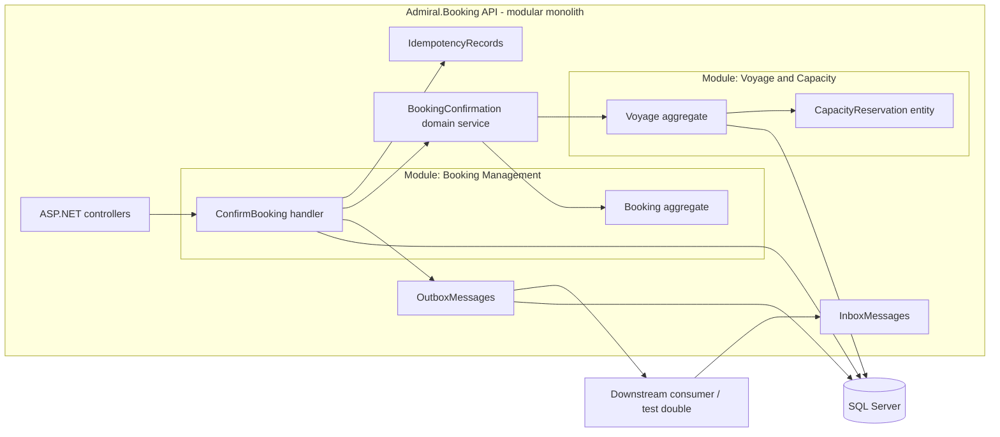

# High-level component / domain view

Deployment boundary: one process. Database boundary: one SQL Server database (command and query connections may be the same). Module boundary: folders and aggregates, not network calls.
