# Event Storming

Discovery artefact for the booking-confirmation / voyage-capacity slice. Conventional colours: orange = actor, blue = command, yellow = domain event, salmon = aggregate, purple = policy, green = external system, pink = hotspot, mauve = business rule.

## 1. Happy path

```mermaid
flowchart LR
  classDef actor fill:#f6b26b,stroke:#333,color:#000
  classDef command fill:#3d85c6,stroke:#333,color:#fff
  classDef event fill:#ffe599,stroke:#333,color:#000
  classDef aggregate fill:#f9cb9c,stroke:#333,color:#000
  classDef policy fill:#b4a7d6,stroke:#333,color:#000
  classDef external fill:#93c47d,stroke:#333,color:#000
  classDef rule fill:#d5a6bd,stroke:#333,color:#000

  actor[Customer / Client]:::actor
  cmdConfirm[Request Booking Confirmation]:::command
  policyIdem[Policy: persist Idempotency-Key + fingerprint]:::policy
  aggBooking[Aggregate: Booking]:::aggregate
  valBooking[Validate Booking]:::command
  ruleBooking["Rules: not Cancelled, not already Confirmed, Voyage referenced, units > 0"]:::rule
  aggVoyage[Aggregate: Voyage]:::aggregate
  valVoyage[Validate Voyage]:::command
  ruleVoyage["Rules: OpenForBooking; not Departed/Cancelled"]:::rule
  cmdReserve[Request Capacity Reservation]:::command
  evReserved[CapacityReserved]:::event
  bookingReserved[Booking CapacityReserved]:::event
  cmdConfirmBooking[Confirm Booking]:::command
  evConfirmed[BookingConfirmed domain event]:::event
  policyOutbox[Policy: write Outbox in same local transaction]:::policy
  pub[Publish booking.confirmed.v1]:::command
  extNotify[External: Notification / downstream consumer]:::external
  inbox[Inbox: record processed EventId]:::policy

  actor --> cmdConfirm --> policyIdem --> aggBooking --> valBooking --> ruleBooking
  ruleBooking --> aggVoyage --> valVoyage --> ruleVoyage --> cmdReserve
  cmdReserve --> evReserved --> bookingReserved --> cmdConfirmBooking --> evConfirmed
  evConfirmed --> policyOutbox --> pub --> extNotify --> inbox
```

## 2. Failure and edge paths

```mermaid
flowchart TB
  classDef command fill:#3d85c6,stroke:#333,color:#fff
  classDef event fill:#ffe599,stroke:#333,color:#000
  classDef policy fill:#b4a7d6,stroke:#333,color:#000
  classDef external fill:#93c47d,stroke:#333,color:#000
  classDef hotspot fill:#e06666,stroke:#333,color:#fff
  classDef rule fill:#d5a6bd,stroke:#333,color:#000

  subgraph Insufficient["Reject insufficient / closed voyage"]
    cmdReserve2[Request Capacity Reservation]:::command
    evRejected[CapacityReservationRejected]:::event
    abort[Booking stays Draft / unconfirmed]:::event
    bizResult[Business result: INSUFFICIENT_CAPACITY or VOYAGE_NOT_OPEN]:::rule
    cmdReserve2 --> evRejected --> abort --> bizResult
  end

  subgraph DuplicateHttp["Handle duplicate confirmation"]
    retryHttp[Same Idempotency-Key + same fingerprint]:::command
    replay[Replay stored result; no new reservation or outbox row]:::policy
    conflictKey[Same key + different payload → IDEMPOTENCY_KEY_CONFLICT]:::rule
    retryHttp --> replay
    retryHttp --> conflictKey
  end

  subgraph Concurrent["Handle concurrent last-seat reservation"]
    twoBookings[Booking A 2u and Booking B 1u on remaining 2u]:::command
    winner[One SaveChanges wins on Voyage.Version]:::event
    loser[Loser: CONCURRENCY_CONFLICT or INSUFFICIENT_CAPACITY]:::rule
    ck[DB final protection: CK_Voyages_ReservedCapacity + UX active reservation]:::rule
    twoBookings --> winner
    twoBookings --> loser
    winner --> ck
  end

  subgraph CrashBeforePublish["Crash after commit, before publication"]
    committed[Booking Confirmed + Outbox Pending already committed]:::event
    crash[Process crash / publish throw]:::hotspot
    retryPub[Retry failed publication from Outbox]:::policy
    committed --> crash --> retryPub
  end

  subgraph Redelivery["Handle duplicate Integration Event delivery"]
    atLeastOnce[At-least-once broker redelivers same EventId]:::external
    inboxHit[Inbox hit → ignore; one downstream effect]:::policy
    atLeastOnce --> inboxHit
  end
```

## 3. Hotspot board

```mermaid
flowchart TB
  classDef hotspot fill:#e06666,stroke:#333,color:#fff
  classDef decision fill:#fff2cc,stroke:#333,color:#000

  h1[Who owns the capacity invariant?]:::hotspot
  d1[Voyage aggregate. ReservedCapacity is not a Booking field.]:::decision

  h2[Should Capacity Reservation live inside Voyage or separately?]:::hotspot
  d2[Entity inside Voyage for this monolith. One consistency boundary. Later extraction would expose a reservation API.]:::decision

  h3[What happens when two Bookings compete for the last units?]:::hotspot
  d3[Optimistic concurrency on Voyage.Version. One winner. Loser retries; capacity check then decides.]:::decision

  h4[What makes a confirmation request idempotent?]:::hotspot
  d4[Persisted Idempotency-Key + SHA-256 fingerprint. Not Booking.Status == Confirmed.]:::decision

  h5[One local transaction for Booking and Voyage?]:::hotspot
  d5[Yes in this modular monolith. A later Voyage service would replace this with an explicit reservation + compensation.]:::decision

  h6[Crash after confirmation but before publication?]:::hotspot
  d6[Outbox row is already committed. Publisher retries. Confirmation is not rolled back.]:::decision

  h7[Which events stay Domain Events vs Integration Events?]:::hotspot
  d7[CapacityReserved, CapacityReservationRejected, BookingConfirmed stay in-process. Only booking.confirmed.v1 crosses the module boundary.]:::decision

  h8[Which DB constraint is the last line of defence?]:::hotspot
  d8[CK_Voyages_ReservedCapacity; UX_CapacityReservations_Booking_Voyage_Active; UX_IdempotencyRecords_Key.]:::decision

  h1 --> d1
  h2 --> d2
  h3 --> d3
  h4 --> d4
  h5 --> d5
  h6 --> d6
  h7 --> d7
  h8 --> d8
```

## Bounded contexts considered

- **Booking Management** (implemented module): Booking lifecycle, confirmation command, HTTP idempotency.
- **Voyage & Capacity Management** (implemented module): Voyage schedule, capacity invariant, CapacityReservation entity.
- Surrounding, not implemented: Customer Management, Pricing, Notification, Shipment Execution.

Deployment boundary: one ASP.NET process. Database boundary: one SQL Server database. Module boundary: aggregates and folders, not HTTP.

## Summary

**Discoveries.** Capacity is a Voyage invariant. Confirmation is a policy that coordinates two aggregates. HTTP retries and broker redelivery are different problems and need different stores (idempotency records vs inbox).

**Ubiquitous language.** Booking, Voyage, Capacity reservation, Confirm booking, Container unit, Idempotency key, Domain event, Integration event, Outbox, Inbox, Concurrency conflict.

**Candidate aggregates.** Booking; Voyage (with CapacityReservation entities). Outbox, inbox, and idempotency records are infrastructure written in the confirmation transaction.

**Candidate bounded contexts.** Booking Management and Voyage & Capacity Management as modules in one deployable.

**Important policies.** On Confirm Booking: validate, reserve, confirm, write outbox, store idempotency result — one local commit. On publish failure: retry pending outbox. On duplicate HTTP request: replay. On duplicate delivery: inbox ignore.

**Main hotspots.** The eight questions in the hotspot board; decisions there drove the implementation.

**Assumptions.** Draft bookings already exist. SQL Server. In-process publisher is enough for the assessment. No pricing or shipment execution.

**Decisions influenced by Event Storming.** Reservation as an entity inside Voyage; single local transaction; transactional outbox rather than publish-after-commit; persisted HTTP idempotency distinct from status checks; inbox for at-least-once consumers; domain events stay internal and only `booking.confirmed.v1` is the integration contract.
